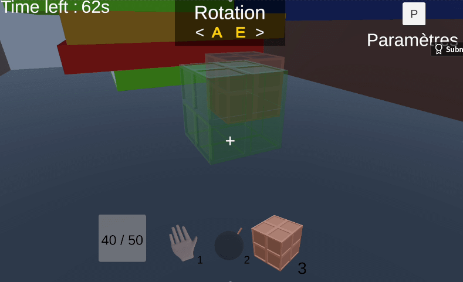
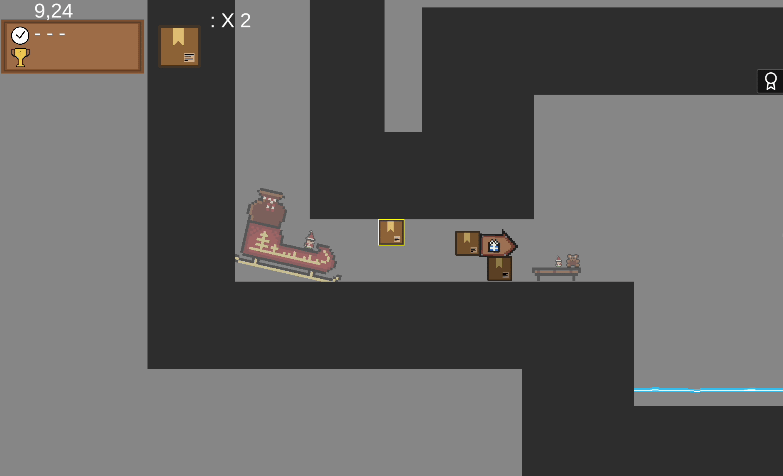
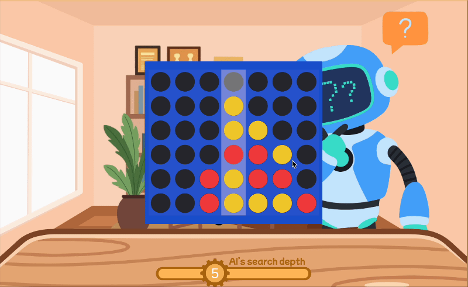

# Mathis Carbillet – Game Code Example

Engineering student at CentraleSupélec (Paris-Saclay University), currently on a gap year as a software engineer at the Paris Digital Lab. I have been developing games for 2 years, mostly during game jams and at my school's game studio, CStudio, using Unity and C#.

This repository contains a few code example from my Unity projects. Each section shows the script, a short video of the behaviour in the game, and a few notes on what it does.

> Excerpts from the shipped builds, cleaned for readability. Behaviour shown in the videos comes from the original builds.

---

## TimeBomb.cs

**Script:** [Scripts/TimeBomb.cs](Scripts/TimeBomb.cs)

**Game:** [MOUSE IN BLACK](https://mathiscblt.itch.io/mouse-in-black) (CStudio / CentraleSupélec game jam, October 2026, team of two)

MOUSE IN BLACK is a 3D physics-based puzzle game. The player chooses which objects to take into a level and uses them to get past each obstacle, with no way back once the level begins. It was created during the CentraleSupélec game jam.

This script describes a placeable bomb. Once placed, it grows and blinks faster as time runs out, then explodes and pushes nearby Rigidbodies away.

- The game has several placeable objects, and they all implement the same `IPlaceable` interface, so the placement system can trigger any of them the same way. `TimeBomb` is one example.
- Depends on other scripts: `IPlaceable` and `PickupItem`.

---

## RewindScript.cs

**Script:** [Scripts/RewindScript.cs](Scripts/RewindScript.cs)

**Game:** [Santa's Delivery](https://mathiscblt.itch.io/santas-delivery) (Resolution Jam 2024–2025, solo)

Santa's Delivery is a fast 2D Christmas platformer. You are the package, and you have to deliver yourself before the clock runs out. Jumping and rewinding time creates copies of your past selves, which replay your previous runs, so you can use them to solve each puzzle. It was created for the Resolution Jam 2024–2025, on the theme "Special Delivery".

This script records a character's trajectory over time, then replays it on a copy.

- Positions and timestamps are stored every frame during recording. Replay compares real elapsed time with the recorded timestamps, so it does not depend on the frame rate.
- **Design choice:** positions are recorded instead of inputs or velocities, so that each copy follows a fixed trajectory. Replaying inputs would make the outcome depend on physics and frame timing, which would break the puzzle's predictability.
- Recording and replay are mutually exclusive: recording ends with `Save()`, and replay starts with `Play()`.
- Needs a `Rigidbody2D` on the same GameObject.

---

## AIPlayer.cs

**Script:** [Scripts/AIPlayer.cs](Scripts/AIPlayer.cs)

**Game:** [Connect 4 vs Alpha-Beta AI](https://mathiscblt.itch.io/connect-4-vs-alpha-beta-ai) (personal project, solo)

A classic Connect 4 game built from scratch to experiment with game theory and search optimisation. You play against an AI whose search depth you can adjust on the fly.

This script contains a Connect 4 AI that chooses a column with Minimax and alpha-beta pruning, limited by a search depth and a time limit.

- Columns are explored from the center outwards, so alpha-beta prunes more branches.
- The board is evaluated by scoring every 4-cell window in the four directions, plus center control and a row-parity heuristic.

---

## Links

- itch.io: [mathiscblt.itch.io](https://mathiscblt.itch.io/)
- LinkedIn: [linkedin.com/in/mathis-carbillet](https://www.linkedin.com/in/mathis-carbillet/)
- Email: mathis.carbillet@student-cs.fr